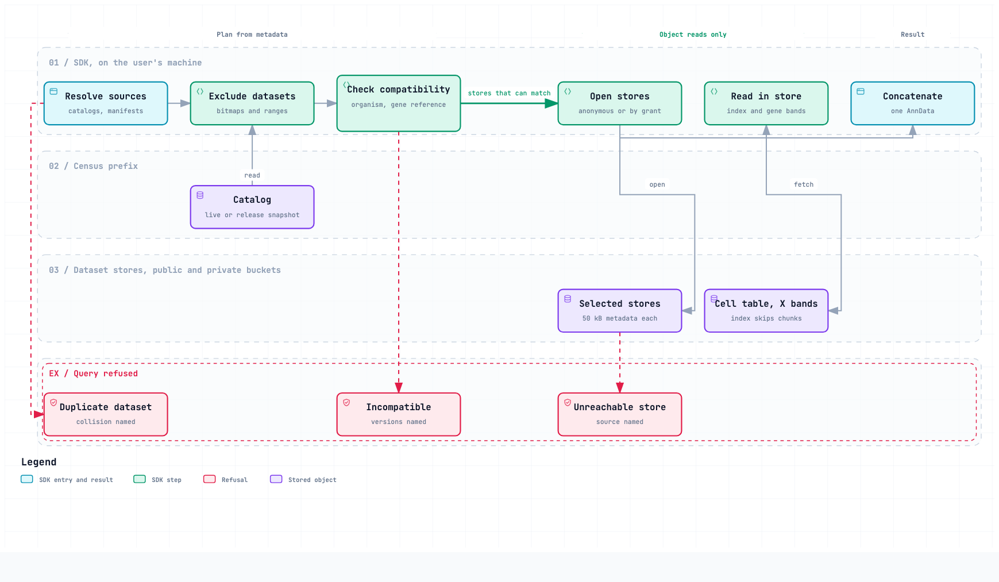

# cellxgene-census2-prototype

This repository holds the prototype of Census 2, the successor to
[CELLxGENE Discover Census](https://github.com/chanzuckerberg/cellxgene-census). The prototype is
in development and is not stable.

Census 2 publishes one AnnData-Zarr store for each dataset that it admits. The census dataset writer writes each
store independently, next to the other artifacts of the dataset. A catalog holds one summary row
for each dataset. At query time, the SDK uses the catalog to exclude the stores that cannot match.
It opens the stores that remain and returns one AnnData. A release pins the exact dataset versions
and a catalog snapshot. The [design record](docs/census_zarr_design_v3_ste100.md) states the
design in full.

<picture>
  <source media="(prefers-color-scheme: dark)" srcset="docs/diagrams/census-query-sequence.dark.png">
  
</picture>

Source: `docs/diagrams/census-query-sequence.workflow.json`. To see the interactive diagram, open
`docs/diagrams/census-query-sequence.html` in a browser.

## Components

| Directory | What it is |
|---|---|
| [`census2-dataset-writer`](census2-dataset-writer/README.md) | A Python package that converts one Discover dataset into one store. It decides admission, the slot set, and harmonization. |
| [`bulk-ingest-nf`](bulk-ingest-nf/README.md) | A Nextflow pipeline that runs the writer over many datasets, locally under Docker or on AWS HealthOmics. |
| [`census2-sdk`](census2-sdk/README.md) | A Python package that queries stores through a catalog and returns one AnnData. |

Each component README holds the setup and use instructions for that component.

## Design documents

The `docs/` directory holds the design record and the disposition table. These markdown files are
canonical. Notion pages mirror them and hold the review comments.

| Document | File | Notion |
|---|---|---|
| The design record, version 3 | [`census_zarr_design_v3_ste100.md`](docs/census_zarr_design_v3_ste100.md) | [page](https://app.notion.com/p/3d816a75378981f18f55c2bae3256a54) |
| The harmonization disposition table, task 4.1 | [`census_zarr_writer_dispositions.md`](docs/census_zarr_writer_dispositions.md) | [page](https://app.notion.com/p/3cf16a75378981cbaa97fab9b7586456) |

Two documents are on Notion only. The
[evidence](https://app.notion.com/p/3b216a75378981a8b76fe2955c600c4d) holds the measurements and
their methods. The [plan](https://app.notion.com/p/3b216a75378981c9b7f3d954789aefe4) holds the
16 phases of the work.

The review threads on the design record stay on the
[earlier version 3 page](https://app.notion.com/p/3cf16a7537898109b010d8dfb6f920fa) until they are
resolved. The [project page](https://app.notion.com/p/38f16a753789806b8fb0e21950fd3659) and the
[tracker](https://app.notion.com/p/95716a7537898228b0150198eacd21dc) hold the epics and tasks.

A README, a docstring, or a pull request cites these documents in a fixed form. A design citation
such as design 2.2 names a section of the design record. A plan citation such as plan Phase 6 names
a phase of the plan. A tracker citation such as tracker 6.1 names a task.

## Develop

[`CLAUDE.md`](CLAUDE.md) holds the lint, format, type-check, and documentation policy. CI runs
`ruff` on each Python component and the tests of each package. The documentation policy applies to
every markdown file, docstring, and code comment in this repository.

## Code of conduct

This project follows the Contributor Covenant
[code of conduct](https://github.com/chanzuckerberg/.github/blob/main/CODE_OF_CONDUCT.md). All
participants must obey it. Send reports of unacceptable behavior to
[opensource@chanzuckerberg.com](mailto:opensource@chanzuckerberg.com).

## Security

Do not open a public issue for a security issue. Send an email to
[security@chanzuckerberg.com](mailto:security@chanzuckerberg.com).
[SECURITY.md](SECURITY.md) states this policy.

## License

The contents of this repository are available under the [MIT license](LICENSE). The file
`docs/diagrams/census-query-sequence.html` also holds two third-party parts with their own licenses:

- The JetBrains Mono font uses the SIL Open Font License 1.1. The HTML file holds the text of that
  license.
- The Archify viewer code uses the MIT license of its authors, in
  [LICENSE-archify](docs/diagrams/LICENSE-archify).
