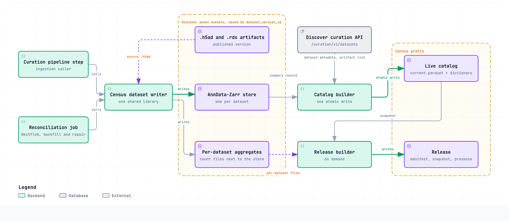
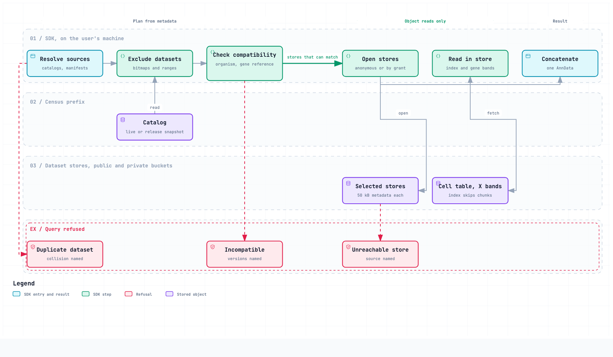

# Publish the Census as per-dataset AnnData-Zarr

**Version 3. Status:** DRAFT, the current design record. **Last edited:** 2026-10-08.

This document is the design record for Census 2. It follows ASD-STE100 and the
[Census 2 documentation policy](https://github.com/chanzuckerberg/cellxgene-census2-prototype/blob/main/CLAUDE.md#documentation-policy).
It replaces the
[earlier version 3](https://app.notion.com/p/3cf16a7537898109b010d8dfb6f920fa). The review
comment threads stay on that Notion page until they are resolved.

## Summary

Census 2 uses one AnnData-Zarr store for each dataset. The census dataset writer
writes each store independently. At query time, the SDK uses a catalog to select
and combine stores.

The design has five primary parts:

1. A store contains one harmonized dataset.
2. The catalog contains one summary row for each dataset.
3. A release contains a manifest and a catalog snapshot.
4. The SDK reads only stores that can contain matching cells.
5. Object storage controls access to public and private data.

Each store is in a Discover asset bucket with the other dataset artifacts. Its
address uses `dataset_version_id` and `writer_version`. The Census does not
keep a second copy of the dataset data. The optional materializations of
section 6.8 are the only exception.

The catalog is in Parquet format. The catalog contains the metadata that the SDK
needs to exclude stores from a query. A release pins exact dataset versions and
writer versions. It also pins the catalog state for that release.

A store is also an access boundary. A user can combine a public release with a
private catalog if the user has access to both sources. The data stays in its
original storage location.

### Storage layout



Source: `diagrams/census-storage-layout.architecture.json`.

### Query sequence



Source: `diagrams/census-query-sequence.workflow.json`.

## 1. Data model

### 1.1 Current corpus

The last LTS build is `2025-11-08`. It contains 1,845 datasets and 217.8 million
observations. These observations come from 125.5 million unique cells and use
1.4 TiB of storage.

Some cells occur in more than one dataset. As a result, the observation count is
larger than the unique-cell count.

The corpus has seven experiments. It has non-spatial data for human, mouse,
macaque, marmoset, and chimpanzee. It also has spatial data for human and mouse.
Human data contains 162 million observations.

Discover continued to accept datasets after Census builds stopped. Discover had
2,216 datasets on 2026-08-19.

### 1.2 Store location and address

Discover stores dataset artifacts in asset buckets. The buckets use
`dataset_version_id` as the key. Public `.h5ad` and `.rds` artifacts are in
`dataset-assets-public-prod`. Users read them through
`datasets.cellxgene.cziscience.com`.

The Zarr store is another artifact for the same dataset version. The store is
next to the existing artifacts. The Census does not copy the store into a
Census-specific data area.

The SDK calculates a store URI from these values:

- `dataset_version_id`
- `writer_version`
- the mirror base URL in the resolved release index

The catalog stores the two identifiers. It does not store the calculated URI.
A private store outside the public buckets has an explicit `store_uri`.

The first `writer_version` is 1. The value is one integer, set in the writer
configuration at deployment. It is the same for every dataset that the
deployment writes. A new value is necessary after a change to the writer code,
a codec, or an input that changes the store. The writer does not look up a
previous value before it writes.

Each writer version has a new address. A store at one `dataset_version_id` and
`writer_version` pair is immutable. The writer refuses to write when a
finalized store exists at the address. A rerun with the same version then
completes an unfinished store or does nothing. A release manifest pins the pair
and its content digest, and retention (section 6.4) keeps each store that a
supported manifest references. Re-curation creates a new `dataset_version_id`.
The previously published dataset version remains available for existing
release manifests.

### 1.3 Store contents

The census dataset writer reads the published `.h5ad` and creates the Census
form of the dataset. The writer applies the applicable Census 1 harmonization
steps.

The writer admits or refuses a complete dataset. It performs these checks:

- The writer applies the reconciliation blocklist.
- The writer checks the curation schema.
- The writer applies the cell filters.
- The writer refuses the dataset if no cells remain.

The cell filters select tissue or organoid `tissue_type` values and the assays
that the experiment permits. The spatial filter also selects
`is_primary_data` cells.

The writer projects genes onto the pinned reference. It adds `tissue_general`,
per-cell statistics, and the normalized layer. It also records the assayed gene
set. The expression matrix cannot show the difference between an unmeasured
gene and a measured value of zero.

The writer keeps only `uns` keys that the curation schema defines.

The differential test in plan Phase 4 must prove that a store gives the same
result as Census 1 for that dataset. The complete list of 39 builder steps is in
[census_zarr_writer_dispositions.md](./census_zarr_writer_dispositions.md).

### 1.4 Store layout

Each store is AnnData on Zarr v3. The tree shows one store and the files next to it.

```text
<store>/                    address from dataset_version_id and writer_version
├── summary record          five numeric ranges, gene_reference_version, assayed gene set
├── inventory               path, size, and checksum of every object
├── obs/                    one Zarr array per column
│   ├── <column>/           chunks of 8,192 rows, shards of 65,536 rows
│   └── obs_index           values and numeric ranges for each chunk
├── var/                    the full pinned gene reference
├── X/                      raw counts, CSR; the encoding is open (section 6.10)
├── layers/normalized/      the normalized layer, same encoding
└── uns/                    the keys that the curation schema defines

next to the store, in the same asset bucket:
└── aggregate files         per-gene counts and per-category counts
```

Writer version 1 writes `X` in anndata's default CSR, and the encoding is open
(section 6.10). Plain CSR has no gene axis. A one-gene read from plain CSR reads
98.7 MB. The same read from banded CSR reads 0.51 MB. A whole-cell read costs the
same in both. See
[evidence section 10](./census_zarr_design_evidence.md#10-layout-comparison).

The SDK reads `obs_index` first. It skips a chunk when the index shows that the
chunk has no matching cells. On the Census 1 human axis, the largest dataset
occupies 2.6 percent of the cell-table chunks. The cell type of median frequency
occupies 0.3 percent. See
[evidence section 10.2](./census_zarr_design_evidence.md#10-layout-comparison).
Section 6.2 decides whether the design keeps this index.

The writer keeps cells in arrival order
([evidence section 10.4](./census_zarr_design_evidence.md#10-layout-comparison)).

The measurements used organism-wide stores. Plan Phase 6 must measure store
size and read cost again on per-dataset stores, for two reasons:

- Dataset-boundary padding has no effect in a single-dataset store.
- A dataset that is smaller than one shard leaves part of the shard unused.

AnnData does not define a representation for Census spatial data. The design
must define a representation for scenes, point clouds, images, and cell-to-scene
relationships.

### 1.5 Gene reference

The `var` table contains the full gene reference that the CELLxGENE dataset
schema specifies. The current references are GENCODE v48 for human and M37 for
mouse.

The `var` table does not use the union of genes in the selected datasets. That
union changes when a dataset enters the corpus. A changing union also
changes gene positions in previously written stores.

All stores of one organism that use the same gene reference version have an
identical `var` table. The catalog records the version in
`gene_reference_version`. A release holds one version for each organism, so the
SDK concatenates the stores of a release by position and needs no gene-list
join. Each store keeps its own copy of `var`, so that a store is a complete
AnnData for a reader outside the SDK.

The human reference has 78,894 rows. The last build assayed 61,497 human genes.
The additional rows do not add expression values for absent genes. See
[evidence section 10.6](./census_zarr_design_evidence.md#106-the-gene-space-is-pinned-upstream-and-how-much-of-it-a-build-sees).

Each release includes a presence matrix for each organism. This matrix records
whether each dataset measured each gene.

A reference update re-curates each dataset (section 3.2). The catalog changes
one organism at a time. Thus, a live query sees one reference version for each
organism.

### 1.6 Cell and gene identity

The cell key is `(dataset_id, observation_joinid)`. The gene key is the
[Ensembl](https://www.ensembl.org/) `feature_id`. A gene symbol is not a unique
identifier.

The cell key uses both columns because `observation_joinid` can have the same
value in different datasets. The writer checks cell-key uniqueness for each
store.

These identifiers do not contain corpus-build positions. A store can keep the
same identifiers when different source sets or releases include that dataset
version.

The identity remains valid for the lifetime of a dataset version. This design
does not add identity guarantees across re-curation.

Discover calculates `observation_joinid` from the author's cell name. The
value stays the same when a re-curation keeps the cell name. This behavior is
not a contract. A renamed cell does not match. Reuse of a cell name
for a different cell can cause an incorrect match.

Cross-release cell identity remains an upstream problem. See
[cellxgene-census issue 25](https://github.com/chanzuckerberg/cellxgene-census/issues/25)
and
[single-cell-curation issue 522](https://github.com/chanzuckerberg/single-cell-curation/issues/522).

Census 1 work can use `soma_joinid`, which is a build row number. A mapping table
for each organism converts the old row number to
`(dataset_id, observation_joinid)`. The release builder creates the mapping from the
last TileDB release and publishes it with each release. An unresolved lookup
returns an error.

## 2. Catalog

The catalog is a Parquet table with one row for each dataset. Pandas, Polars,
DuckDB, Arrow, and R can read this format without a Census-specific dependency.

### 2.1 Catalog fields

| Group | Fields |
| --- | --- |
| Identity | `dataset_id`, `dataset_version_id`, `writer_version`, `n_obs` |
| Partition | `organism`, `spatial` |
| Conformance | `gene_reference_version`, `curation_schema_version`, `census_schema_version`, `census_eligible`, `ingested_at` |
| Query exclusion | 18 category bitmaps, five numeric ranges, and an `is_primary_data` tri-state |
| Description | `dataset_title`, `collection_id`, `collection_name`, `collection_doi`, `citation` |

The five numeric ranges are per-dataset minimum and maximum values. They cover
the Census 1 per-cell statistics `raw_sum`, `nnz`, `raw_mean_nnz`,
`raw_variance_nnz`, and `n_measured_vars` (disposition rows 27 and 28). A
numeric filter excludes a dataset when its range cannot contain a match.

The catalog does not contain a URI for a public store. The SDK calculates the
URI from the dataset version and writer version. A private row can contain an
explicit `store_uri`.

### 2.2 Dataset selection

The catalog has indexes for 18 columns. Sixteen columns are eight pairs of label
and ontology-identifier columns:

- `assay`
- `cell_type`
- `development_stage`
- `disease`
- `self_reported_ethnicity`
- `sex`
- `tissue`
- `tissue_general`

The other two columns are `suspension_type` and `tissue_type`.

Each index is a bitmap over a global category dictionary. One bit identifies
one possible value. A set bit means that the dataset contains the value.

The indexed columns contain 3,834 distinct values. The bitmaps for one dataset
use approximately 480 bytes. The complete uncompressed catalog uses 2.8 MB. The
compressed Parquet file uses less than 1 MB.

Parquet reads only the columns that a query needs. An exclusion query does not read
the descriptive columns.

The catalog excludes complete datasets from a query. The per-chunk index
excludes chunks in the stores that remain. Both indexes can use the same
implementation rules.

The catalog does not index `donor_id`. A bitmap for each of its 11,633 distinct
values makes the catalog too large, and a donor id has meaning only inside
one dataset. A query for this column reads the column data.

The catalog does not contain the gene-presence matrix. Human presence uses 78,894 bits for each dataset. Each store records its assayed
gene set. The release builder uses these sets to build the matrix.

The catalog also does not contain corpus-wide aggregates. These aggregates
describe a release. The live catalog does not carry them.

The description fields replace the Census 1 `census_info/datasets` table.

### 2.3 Discover metadata

The catalog builder reads the unauthenticated Discover endpoint
`/curation/v1/datasets`. One request returns all public datasets. The response
contains 16 of the 18 indexed columns. It also contains description fields,
lifecycle state, and the `assets` array.

The catalog builder uses this response for metadata that Discover owns. The
catalog column set follows the curation schema. This keeps the catalog consistent
with schema changes. The Census does not maintain a separate list of metadata
that Discover owns.

Discover does not provide these values:

- five numeric ranges
- `tissue_general`
- gene reference version
- bitmap encoding

The writer puts the numeric ranges and gene reference version in the store
summary record. The catalog builder reads this record, but it does not read
array data.

A store enters the catalog after the Discover response lists the Zarr artifact.

The Discover API is a build-time dependency. It is not a query-time dependency.
The API response is 9.6 MB of JSON. A query-time API call also returns the
current state instead of the state in a pinned release.

## 3. Write and release process

### 3.1 Ingestion

The census dataset writer creates an immutable store during dataset ingestion.
The catalog builder then adds a row. The dataset becomes available to live
queries without a Census release.

The writer reads only one dataset. The catalog builder performs the remaining
metadata operations that need a fixed set of datasets.

The catalog records admission in `census_eligible`.

Embedding inference for one dataset can run at ingestion time. Model training
reads the complete corpus, so it needs a release. See section 6.7.

### 3.2 Gene reference update

A gene reference update causes a Discover schema migration. Each dataset gets a
new store that uses the new reference.

The live catalog continues to use the old reference until the conversion
of all applicable datasets is complete. The catalog then changes that organism
in one atomic operation. Organisms migrate independently. The stores of one
organism in the live catalog use one reference version at any time.

The conversion set is the organism's catalog rows at the start of the migration.
A tombstoned dataset leaves the set. A conversion failure blocks the change
until the dataset converts or leaves the set.

A new dataset can arrive during the migration. The writer uses the new reference
for that dataset. The dataset waits for the catalog change before it becomes
queryable. The catalog shows which stores still use the old reference.

### 3.3 Release contents

Ingestion does not create a release. A release is a deliberate snapshot that a
publication can cite. The five-year support commitment applies to releases.

Two operations write under the Census prefix. The catalog builder owns
`catalog/`. The release builder owns `releases/`. They are separate programs with
separate triggers.

```text
<census prefix>
├── catalog/                    the catalog builder writes this directory
│   ├── current.parquet         the live catalog, one atomic write per update
│   └── dictionary.parquet      the live dictionary, append-only
└── releases/2026-09-01/        the release builder writes this directory
    ├── manifest.json           written last, the completion signal
    ├── catalog.parquet         snapshot of the live catalog
    ├── dictionary.parquet      snapshot of the live dictionary
    ├── presence/               one matrix for each organism
    └── aggregates/             corpus-wide aggregates
```

The live dictionary is append-only. A release contains a snapshot of the live
catalog and dictionary. The release also contains presence matrices and
corpus-wide aggregates.

The manifest lists the dataset versions and writer versions. It includes one
content digest for each store. It also includes the gene reference version and
digests for the other release files.

The catalog builder runs after each ingestion or reconciliation run. It reads
the summary record of each new store and the Discover response (section 2.3). It
appends new values to the dictionary. It writes `catalog/current.parquet` and
`catalog/dictionary.parquet` in one serialized atomic write. The dataset becomes
available to live queries after this write.

The release builder assembles a release on demand. It reads the live catalog
and dictionary at one point in time and the inventory of each store. It performs
these operations without expression reads:

1. It copies the catalog and dictionary into the release directory.
2. It builds the presence matrices from the assayed gene sets.
3. It builds the corpus-wide aggregates from the per-dataset files (section 3.4).
4. It compares each store with its writer inventory and stops on a mismatch.
5. It publishes the manifest last, and then adds the release to the release
   index (section 3.5).

A release query uses the catalog snapshot in that release. Later catalog writes
do not change the release. Each release is a new directory, so two release
builds cannot collide. The catalog builder keeps the one-writer rule of section
3.6.

### 3.4 Derived per-dataset files

The writer creates small files for per-gene counts and per-category counts. The
files are next to the store and are not part of the immutable store.

Each file key includes the dataset version, writer version, and aggregate
version. A new aggregate definition creates new files. A new store is not
necessary.

The release builder combines the per-dataset files. It derives
`n_measured_obs` from the assayed gene set and `n_obs`.

### 3.5 Release discovery

The SDK uses the existing release index at
`census.cellxgene.cziscience.com`. The index contains catalog and manifest
entries next to the `soma` and `h5ads` entries.

The index keeps `soma` entries while a supported TileDB release exists.

### 3.6 Writer operation

The design has one library, the census dataset writer, and two callers.

The curation pipeline is the first caller. A new pipeline step writes
the Zarr store and registers the Zarr artifact. The Census 2 team owns this step.

A Nextflow reconciliation job is the second caller. It runs on AWS HealthOmics
for the prototype, and the production runtime is open. The job supports
scheduled and on-demand runs. It handles these cases:

- Backfill for existing datasets.
- A new `writer_version` after a writer or codec fix.
- Repair after an ingestion failure.

The reconciliation job compares published dataset versions with catalog rows.
It writes missing stores. Both callers then invoke the catalog builder.

The catalog builder uses one serialized atomic write. Both callers must produce
byte-identical stores. The differential harness checks this requirement. These
questions are open:

- How does the reconciliation job register an artifact?
- What mechanism allows only one catalog write at a time?
- Where does the reconciliation job run in production?

### 3.7 Writer inputs

The writer receives three inputs for each dataset. It fetches nothing at run time.

1. The dataset: the published `.h5ad` in the Discover asset bucket. In the curation
   pipeline, the file is local to the pipeline.
2. Reference data: bulk files with their own release schedule.
   - The pinned gene reference for each organism, with feature id, name, length, and
     biotype (section 1.5).
   - The tissue roll-up that derives `tissue_general`, from `cellxgene_ontology_guide`.
3. Policy configuration: small values that change with a Census release.
   - The experiment definitions: the organism term and the permitted assays for each
     experiment.
   - The `tissue_type` values that the cell filter keeps, and the spatial
     `is_primary_data` rule.
   - The 21 full-gene assay terms that receive gene-length correction in normalization.
   - The curation schema version that the corpus declares.
   - The `uns` allowlist.
   - The reconciliation blocklist.

The caller stages the reference data and the configuration before the run and passes
their location. The library resolves each file and records the version or digest of each input in the summary record. It also
records its own version. Two callers that pass the same
inputs write identical stores. An input change that changes the store is a new
`writer_version`.

The writer reads staged inputs because its two runtimes differ. A HealthOmics
task, the prototype runtime, has no internet access by default. The curation pipeline step runs in a
different environment. With staged inputs, the writer reads the same data in both runtimes. The
writer does not call the Discover API. The catalog builder (section 2.3) and the
manifest step of the reconciliation job call it.

## 4. SDK access

### 4.1 API

Census 2 can use a new major version of `cellxgene-census` or a new package. The
API keeps the handle-and-accessor pattern.

The Census 2 SDK reads Zarr releases only. TileDB releases stay readable with the
1.x package until they leave support (section 4.6). The identity mapping
(section 1.6) connects the two.

`open_census()` replaces `open_soma()`. It accepts catalogs and release
manifests as sources. A release manifest refers to a pinned catalog. Thus, the SDK
can combine a release and a private catalog with the same mechanism.

The SDK performs query fan-out. The read path uses object storage. It does not
need a query service.

Existing accessors keep their result shapes. `get_presence_matrix()` reads a
published presence matrix or builds one from store assayed sets. The presence
matrix and `var` aggregates describe the selected source set.

`get_anndata_lazy()` is a new accessor. It describes a query. It does not load the
complete result.

The SDK no longer provides `get_default_soma_context()`.

### 4.2 Selection and filter interface

The SDK selects cells with `(dataset_id, observation_joinid)`. It selects genes
with Ensembl accessions. A fast path that selects genes by position is valid only inside one release.

Census 2 uses a new filter interface. It does not accept TileDB-SOMA filter
strings. An error for an old filter includes the equivalent new filter. The
migration guide contains the same translator.

The new language has explicit membership syntax for multi-valued columns such
as `disease` and `disease_ontology_term_id`. The curation schema identifies
multi-valued columns.

The TileDB filter language remains available through supported TileDB releases.

One query can use sources in different buckets. The SDK can need more than
one storage credential.

### 4.3 Additive source composition

A query appends rows from all sources. It does not merge or deduplicate cells.

```python
adata = open_census(sources=[public_release, my_lab_catalog]).get_anndata(
    organism="Homo sapiens",
    # The filter interface is an open item.
    filter="tissue_general == 'lung' and cell_type == 'macrophage'",
)
```

The call returns one AnnData object.

Before concatenation, the SDK performs these checks:

- The result contains one organism.
- All stores use the same `gene_reference_version`.
- Spatial and non-spatial stores are not in the same result.
- A `dataset_id` occurs in only one source.

The SDK reports the conflicting values when a check fails. It does not remap a
gene reference during a query.

Concatenation is not data integration. Batch effects and assay differences stay
in the result. The result includes a normalization layer.

The result contract for a mix of ingested and not-yet-ingested datasets is open.

### 4.4 Query execution

`open_census(sources=[...])` accepts catalogs and release manifests. This
sequence describes an SDK query across one public release and one
private catalog.

1. The SDK reads each catalog and dictionary. It resolves a release through its
   catalog snapshot. It reports an error if a `dataset_id` occurs in more than
   one source.
2. The SDK uses category bitmaps and numeric ranges to exclude datasets.
3. The SDK checks organism, spatial type, and `gene_reference_version`
   compatibility.
4. The SDK opens the remaining stores. It uses anonymous access for public stores.
   It uses the provider credential chain for private stores. It reports an error
   if a store is not accessible.
5. The SDK uses the per-chunk index to exclude cell-table chunks. It reads the
   expression data that the query needs.
6. The SDK appends the selected rows. It aligns genes by position in the pinned
   reference.

After store selection, all external reads are object-store reads.

### 4.5 Private data

The design supports two types of private data.

The first type is a Discover collection with `visibility: PRIVATE`. The curation
pipeline writes a Zarr artifact for the collection. The public
`current.parquet` does not contain its catalog row. An authenticated process
writes the row to a private catalog. The catalog and store use the same grant.

The second type is a lab dataset outside Discover. The lab runs the census
dataset writer and builds a catalog for its stores.

Object storage enforces access. The SDK passes credentials to the storage
provider. The catalog needs the same protection as its stores because its
metadata can disclose dataset contents.

The current defaults are:

- One grant covers a catalog and its stores.
- An access-controlled file contains private catalog URIs.
- The SDK resolves credentials for each source.
- One inaccessible source causes the complete query to fail.
- The error identifies the inaccessible source.

These defaults can change after the private-access decision.

### 4.6 Existing user support

Previously published data stays at its existing address. A pinned SDK and
release continue to resolve the same data. The five-year LTS commitment controls
TileDB retirement.

After the first Zarr release, new releases use Zarr only. Users receive a
published migration schedule. A user who stays on the old SDK can read the last
TileDB release until support ends.

The first Zarr release has two compatibility gates:

1. Both storage stacks must return the same cells, genes, values, and metadata
   columns for the differential query corpus.
2. A contributed embedding must join through the identity mapping. A failed
   join must return an error.

See [evidence section 11](./census_zarr_design_evidence.md).

The R client continues to read TileDB releases until it can read the Zarr format.
The proposed path uses
[anndataR](https://bioconductor.org/packages/anndataR/) with
[Rarr](https://bioconductor.org/packages/Rarr/). Current sharded reads return
incorrect data. An upstream fix is necessary. R support is a condition for
TileDB retirement.

## 5. Alternatives

### 5.1 One store for each organism and modality

The alternative is seven stores, one for each organism and modality. A
per-dataset store has approximately 50 kB of metadata. To open all 1,086 human
stores, the SDK transfers 54 MB of metadata. A complete Census 1 query from the documentation can transfer 3.4 MB.

The per-dataset design has two requirements that are more important than this
opening cost. Ingestion without a corpus build needs one store for each
dataset. A store cannot span access grants. One grant can cover multiple
stores.

Datasets with the same grant can share a store. But a dataset's access
grant can change when its embargo ends or it becomes public. A shared store
then needs data copies between stores. Separate stores avoid these copies.

The catalog reduces the opening cost. The SDK opens only stores that can contain
matching cells. Section 6.1 measures the cost that remains. Section 6.8 describes
a second copy of the data, grouped for corpus-wide queries, next to the
per-dataset stores.

### 5.2 Expression-matrix encodings

The `X` encoding is open (section 6.10). The tests compared banded CSR with
plain CSR, gene-major CSC, and a dense array. Banded CSR used the least storage.
A complete-cell read was within 0.4 percent of plain CSR. See
[evidence section 10](./census_zarr_design_evidence.md#10-layout-comparison).

## 6. Open work

### 6.1 End-to-end measurement

The store-layout measurements used organism-wide stores. Phase 6 must measure
real per-dataset stores before design approval. The measures are store size,
object count, transferred data, and request count for the four documented
filters (evidence section 10.1). Elapsed time is measured inside `us-west-2`.

The cost to open many stores is the main risk of the per-dataset design
(section 5.1). Two measurements decide whether this cost is acceptable. Neither
measurement needs a full ingest.

1. Fan-out distribution. The test resolves a set of queries against a catalog
   of all Discover datasets. It counts the stores that each query opens. The
   query set includes the documented filters, the harness query corpus, and
   Census 1 usage logs if they exist. The documented filters open 10, 45, 92,
   and 447 human stores
   ([evidence section 10.5](./census_zarr_design_evidence.md#105-one-store-uniform-obs-chunks-dataset-aligned-x-chunks)).
2. Open cost as a function of store count. The test opens N stores from inside
   `us-west-2` at several concurrency levels. It records elapsed time, request
   count, transferred data, throttling, and errors. To open one store, the SDK
   reads about 50 kB of consolidated metadata for any store size. Thus copies of
   existing stores are valid inputs for this test.

The team names an elapsed-time limit for an interactive query before the test.
If common queries exceed this limit, the per-organism store of section 6.8 moves
forward.

### 6.2 Per-cell `obs` frame

A release-wide, lazy `obs` table with one row for each cell is an open item.
The proposal uses one Parquet fragment for each dataset. The census
dataset writer puts the fragment next to the store. Each row includes the store row
ordinal.

PyArrow, DuckDB, and Polars can read a list of fragments as one table. These
engines can apply predicate pushdown. A query returns `(dataset_id, row ordinal)`
pairs, which the SDK uses for expression reads.

A private fragment uses the same grant as its store. The proposal does not
change the access model.

The proposal duplicates the `obs` data. The writer must also keep the fragment
consistent with the store cell table.

Phase 6 must compare three designs:

1. The current design: catalog bitmaps, then the per-chunk index inside each
   open store.
2. Chunk-grained: catalog bitmaps, then per-chunk summaries published with the
   catalog.
3. Per-cell fragments: catalog bitmaps select candidate fragments, then the
   query engine reads the fragments.

The test uses the four documented filters. It measures transferred data and
request count. The test must also count datasets that pass a two-predicate
catalog test but contain no matching cells. The current estimate of the opening cost assumes exact catalog selection.

[Apache Iceberg](https://iceberg.apache.org/) is the candidate package for the
frame. The Parquet fragments are Iceberg data files next to the stores. The
catalog builder writes the Iceberg metadata under the Census prefix. One catalog
update is one Iceberg commit.

Iceberg manifests contain column bounds for each file. A query engine can use
the manifest to exclude fragments. It does not need to read each Parquet footer.
The release builder can tag an Iceberg snapshot as a Census release. Iceberg schema evolution can
record curation-schema changes.

The evaluation must confirm that the catalog builder can commit without an
Iceberg catalog service. This service holds the current metadata pointer of an
Iceberg table. It is not the Census catalog. The evaluation must also cover R
support.

### 6.3 Spatial representation

[SpatialData](https://spatialdata.scverse.org/) is the scverse counterpart for
spatial data and is already an SDK dependency. The design must specify scenes,
point clouds, images, and cell-to-scene relationships.

### 6.4 Storage locations and retention

The team must select storage for Zarr stores, catalogs, and manifests. Stores
can share the asset buckets or use a separate bucket, such as the `.cxg` bucket.

Retention must keep each version that a supported manifest references. A
tombstone must not make a supported release unreadable. Published versions must
remain available for the five-year commitment.

### 6.5 Private discovery and errors

The private-access design must answer these questions:

- Does a shared catalog list private datasets with hidden bitmaps?
- Does discovery use a registry file or an identity-aware service?
- What credential API does the SDK use for each source?
- Does one inaccessible source fail the query or return an explicit partial
  result?
- Does an error identify a source and disclose that the source exists?

### 6.6 Mixed conformance

A result can contain sources with different metadata columns. The design must
provide per-row provenance or define a common minimum column set.

### 6.7 Embeddings

Hosted embeddings are per-dataset artifacts. A row key uses
`observation_joinid`. The artifact also records the model name and version.

Existing embedding tables can move through the identity mapping. Conversion of
the newest table for each model needs approximately 1.36 TB in total. See
[evidence section 16](./census_zarr_design_evidence.md#16-the-hosted-embeddings-inventory-and-generation-mechanism).

Inference for a new dataset is a local operation that the writer can call. The
team must assign ownership for ingestion-time inference and model retraining. A
retrained model creates a new version. Rows from different model versions do
not join.

### 6.8 Compaction and other materializations

A materialization is a second copy of data, grouped or encoded for one access
pattern. It is next to the per-dataset stores and does not replace them. These
are two examples:

- A per-organism store for corpus-wide queries. Compaction combines stable
  datasets into this store. The measurements of section 6.1 are the input for
  this decision.
- A gene-major (CSC) copy of `X` for each dataset, for gene queries. Section
  6.10 decides this copy together with the `X` encoding.

The per-dataset stores stay the primary copy. Private data continues to use
per-dataset stores, so the SDK must support the uncompacted path. The design
defers this work.

Continuous ingestion adds datasets after a materialization exists. The process
that writes the materialization must then append the new datasets or rebuild the
store. An append to a
large sharded Zarr store under continuous ingestion is an open question.

For model training, [annbatch](https://annbatch.readthedocs.io/) writes a
pre-shuffled, sharded collection from AnnData files or Zarr groups. A user can
write an SDK result to disk and then build this collection from it. The user
owns this materialization, and the Census does not build it.

### 6.9 Multi-modal data

Multi-modal data is outside the current scope. A future modality can use another
artifact under the same `dataset_version_id`. The key
`(dataset_id, observation_joinid)` can align cells across modalities.

### 6.10 `X` encoding

Writer version 1 writes `X` in anndata's default CSR. Plain CSR has no gene
axis, so a gene-selective read costs the whole matrix. Banded CSR recovers the
axis for a one-gene read and gains little on a scattered marker panel. See
[evidence section 10.3](./census_zarr_design_evidence.md#103-x-encoding-banded-csr-recovers-the-gene-axis).
The Census 2 team decides the encoding with scverse, so that a plain anndata or
anndataR reader can open the store. Every store written before the decision is
rewritten at a new writer version.

CSC is an anndata encoding. A CSC copy of `X` in a separate store next to the
per-dataset store gives a gene axis. A plain anndata reader can open it. In
the test matrix, the CSC store used 115.1 MB and the CSR store used 98.7 MB. A
one-gene read transferred 4.65 MB from CSC and 98.71 MB from CSR. For the test
matrix, CSR plus the CSC copy used approximately 2.17 times the storage of CSR
alone (section 6.8).

## 7. Decisions

The plan and tracker use these decision numbers.

1. **Census schema 3.0.0.** The new encoding needs a major schema version.
   Decide whether to branch from the published schema 2.4.0 or wait for schema
   2.4.0 to become final.
2. **Release policy.** Add Zarr releases while supported `soma` entries remain.
   Resolve the missing `V<#>` alias. Add a build-time conformance check. Put the
   five-year commitment in the policy and the documentation site.
3. **Identity mapping retention.** Define whether the mapping remains available
   after the transition period.
4. **SDK package.** Select a new major version or a new package.
5. **`soma_joinid` stability.** This decision is complete. Review confirmed on
   2026-09-09 that `soma_joinid` is per-build. Upstream work did not define
   cross-release cell identity. Phase 1 records the formal approval.
6. **Schema amendment scope.** Define the catalog, dictionary, manifest, writer
   summary record, per-chunk index, and per-dataset aggregate files. Specify
   nulls, multi-valued fields, dictionary versioning and extension, ranges,
   bitmaps, and aggregate versioning. An exclusion can remove data only
   when absence is certain. It must not create a false negative. Define the
   predicates that need a complete column read.
7. **Identity mapping source.** Confirm that the last TileDB release is the
   source because it contains the old row numbers.
8. **Writer and ingestion ownership.** The Census 2 team owns the curation
   pipeline change (2026-09-14). Assign ownership for the continuing ingestion
   operation. The current design uses one writer library from the curation
   pipeline and the reconciliation job.
9. **Code location.** Select a repository for the writer, catalog builder,
   release builder, and SDK. This repository remains the Census 1 oracle until
   cutover. A public pull request in this repository retains its commits. The
   shared writer must be in a location that both callers can use.

## 8. Required design details

The implementation must not select these behaviors without design approval:

- Keep all category labels in a result, or keep only labels that the result uses.
- Store `var.feature_name` as a string or a categorical value.
- Return an error for a gene symbol that identifies multiple genes, or document
  that the query returns all matching genes.

The design must define these items before implementation:

- Confirm the adaptive per-chunk index rule.
- Define the filter interface.
- Define the per-dataset aggregate file format and version.

A per-cell `obs` frame can reduce what the filter interface must express. The frame
can use the query engine expression language. `get_anndata()` still needs a
defined selection interface.
